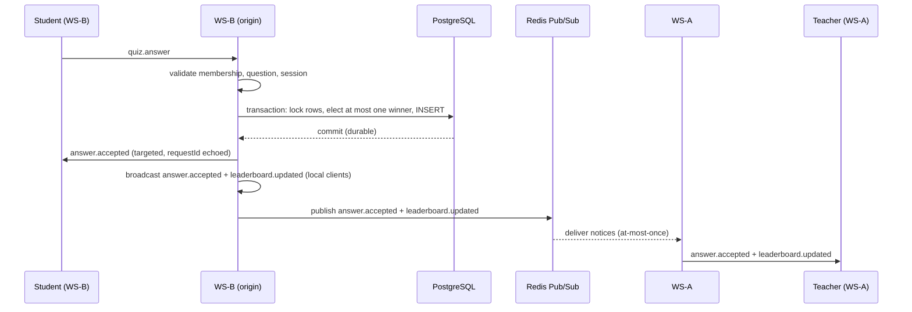
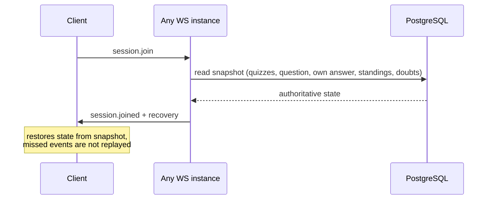

# LivePulse

Real-time classroom infrastructure: live quizzes with first-correct-answer-wins semantics, an ordered doubt queue, presence, and reconnect recovery — over raw WebSockets, backed by PostgreSQL, scaled across instances with Redis Pub/Sub.

Source: <https://github.com/AkprasadoP/LivePulse>

Stack: TypeScript (strict, ESM) · Node.js ≥ 22 · Fastify 5 · `ws` 8 · Prisma + PostgreSQL 17 · Redis 7 (Pub/Sub notices only) · Zod · Pino · `prom-client` · Vitest · Docker Compose · Nginx (reverse proxy) · Next.js frontend in `web/`.

## What it does

- **Live quizzes** — a teacher starts a quiz and publishes/closes questions; students answer over WebSocket and the server grades every submission.
- **First-correct-wins election** — concurrent correct answers serialize in the database so at most one winner per question is ever recorded.
- **Doubt queue** — students raise doubts with server-assigned ordering; teachers resolve or dismiss them; every client sees the same queue.
- **Presence** — ephemeral online sets derived from live connections, shared across instances.
- **Reconnect recovery** — any rejoin returns a PostgreSQL snapshot (quizzes, current question, own verdict, standings, open doubts); missed live events are never replayed.
- **Authenticated identity** — JWT-bound participants resolved server-side; unauthenticated joins are view-only.

## Architecture

Normal path — student on WS-B answers, teacher on WS-A observes:



Reconnect recovery — any instance serves the same snapshot from PostgreSQL:



> Failure window: if the origin crashes after the PostgreSQL commit but
> before the Redis publish, remote connected clients miss the notification.
> Rejoining repairs state through the PostgreSQL snapshot; automatic
> reconciliation for already-connected clients is not implemented. No
> transactional outbox exists.

## Guarantees and limitations

**Holds:**

- PostgreSQL is the durable source of truth; Redis never owns business data.
- Winner election serializes on a question row lock with a partial unique index enforcing at most one winner per question.
- Duplicate submissions replay the stored verdict, persist no second row, and emit no re-broadcast.
- Reconnect snapshots are read purely from PostgreSQL on every `session.join`.
- Heartbeat cleanup terminates dead peers and releases per-session bookkeeping.
- Redis Pub/Sub carries post-commit cross-instance notifications only.

**Limitations — do not rely on these:**

- Redis application events are **at-most-once**: no durable outbox, replay log, acknowledgement, or retry exists.
- A commit-before-publish crash can leave already-connected remote clients stale until another relevant event arrives or they rejoin.
- No outbound WebSocket high-water mark or bounded queue is implemented.
- Slow-reader and answer-storm behavior beyond the snapshot below is unmeasured.

## Performance snapshot

Join-only local baseline — connect + one `session.join` round-trip per virtual user (not a throughput or capacity benchmark):

```bash
node load-tests/run.js --vus {10,25,50,100} --duration 20s --scenario websocket-connections
```

| VUs | Succeeded | Failed | Establishment p50/p95/p99 (ms) | Join RTT p50/p95/p99 (ms) |
| --: | --------: | -----: | ------------------------------ | ------------------------- |
|  10 |        10 |      0 | 8.68 / 8.88 / 8.99             | 61.50 / 69.02 / 69.16     |
|  25 |        25 |      0 | 13.41 / 13.75 / 13.84          | 74.74 / 90.10 / 90.47     |
|  50 |        50 |      0 | 31.32 / 32.57 / 32.57          | 57.47 / 62.54 / 62.69     |
| 100 |       100 |      0 | 48.69 / 50.02 / 50.10          | 86.31 / 89.70 / 89.94     |

Environment: macOS M2, 16 GB RAM, Node.js v26.3.0, PostgreSQL 17 + Redis 7 via Docker Compose, same-machine generator and development server. Zero timeouts, protocol errors, and unexpected closes; health checks stayed green. This describes one shared dev machine — not production capacity, sustained throughput, or answer/broadcast-storm behavior.

Slow-consumer experiment (`tests/integration/ws-backpressure.test.ts`): split-instance runs with 30 paced 1000-character broadcasts at ~20 events/s, generator on one instance and a frozen reader plus fast observers on the other. Across two runs all 30 events arrived in order on both instances, the frozen reader caught up after resuming, and nothing disconnected — while server-side `bufferedAmount` stayed at 0 bytes. The offered backlog likely fit in kernel TCP buffers, so server backpressure was **not** triggered at this workload. No leak, capacity, or never-occurs claim follows from this.

## Quick start

Prerequisites: Node.js ≥ 22, `pnpm@12.5.1`, Docker + Docker Compose.

```bash
# 1. Dependencies + test database (PostgreSQL on 5433, Redis on 6380)
pnpm install
pnpm db:up
cp .env.example .env          # then edit if needed
pnpm db:test:setup            # one-time: create livepulse_test + apply migrations

# 2. Backend (HTTP + WebSocket on :3000)
pnpm dev                      # watch mode, or: pnpm build && pnpm start

# 3. Frontend on :3001 (backend stays on :3000)
cd web && PORT=3001 pnpm dev
```

| Service            | URL                       |
| ------------------ | ------------------------- |
| Frontend (Next.js) | <http://localhost:3001>   |
| Backend API        | <http://localhost:3000/*> |
| WebSocket          | `ws://127.0.0.1:3000/ws`  |

```bash
pnpm typecheck              # strict TypeScript check
pnpm test:unit              # unit tests (no database required)
pnpm test:integration       # integration tests vs real PostgreSQL + Redis
pnpm test:all               # both suites
```

Containerized two-instance deployment, Nginx proxy, readiness, and graceful drain are documented in `docs/architecture/production.md`.

## Documentation

- `docs/architecture/overview.md` — components and key design decisions
- `docs/api/websocket-protocol.md` — envelope, events, error codes, limits
- `docs/architecture/production.md` — containers, proxy, readiness, failure behavior
- `docs/testing/load-testing.md` — benchmark methodology and measured results
- `docs/decisions/` — architecture decision records (ADR-001–009)
