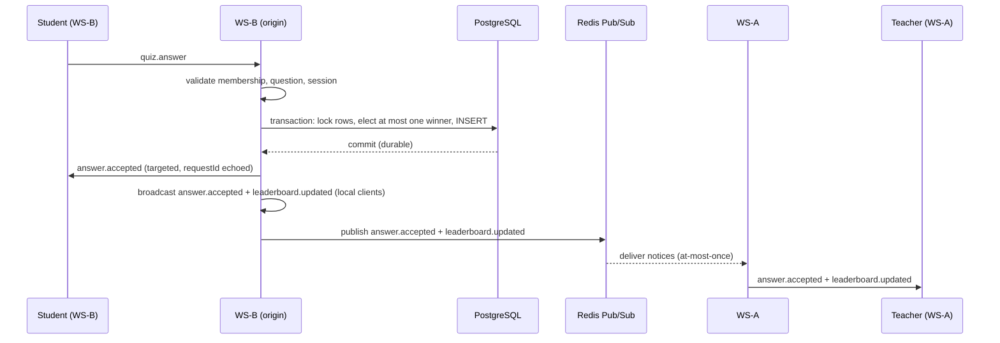

# LivePulse

Real-time classroom infrastructure: live quizzes with first-correct-answer-wins
semantics, a doubt queue with defined ordering guarantees, presence, and
reconnection with server-side state recovery.

**Engineering principles, phase plan and honesty rules live in `AGENT.md`.**
Architecture: `docs/architecture/overview.md` · WebSocket:
`docs/architecture/websocket-architecture.md` · API: `docs/api/http-api.md` ·
Auth: `docs/api/authentication.md` ·
WS protocol: `docs/api/websocket-protocol.md` · Schema:
`docs/database/schema.md` · Decisions: `docs/decisions/`.

## How an answer travels (two instances)

Normal path — student on WS-B answers, teacher on WS-A observes:



Reconnect recovery — any instance serves the same snapshot from PostgreSQL:

```mermaid
sequenceDiagram
    participant Client as Client
    participant Any as Any WS instance
    participant PG as PostgreSQL
    Client->>Any: session.join
    Any->>PG: read snapshot (quizzes, question, own answer, standings, doubts)
    PG-->>Any: authoritative state
    Any->>Client: session.joined + recovery
    Note over Client: restores state from snapshot;<br/>missed events are not replayed
```

> Failure window: if the origin crashes after the PostgreSQL commit but
> before the Redis publish, remote connected clients miss the notification.
> Rejoining repairs state through the PostgreSQL snapshot; automatic
> reconciliation for already-connected clients is not implemented. No
> transactional outbox exists.

## Current implementation status

**Phases 1–11 complete** (foundation → real-time classroom → distributed
WebSockets → recovery → presence/observability → production infra →
authentication → Phase 11 security hardening):

- Everything from Phases 1–2: typed Fastify HTTP server, fail-fast Zod
  config, Pino logging, graceful shutdown, liveness-only `/health`, the
  7-entity PostgreSQL domain schema, the race-safe session state machine,
  the session/quiz REST API, and the raw-`ws` WebSocket layer (shared port,
  envelope protocol, ephemeral registry, heartbeat, `preClose` shutdown)
- Authenticated identity (Phase 10.7): `session.join` binds a
  `session_participants` row for the authenticated user, resolved server-side
  by `(sessionId, userId)` (find-or-create, race-safe); `displayName` is
  presentation only. Unauthenticated joins are view-only. The Phase 3
  displayName identity seam is removed
- Quiz/question lifecycles driven over WebSocket (teacher-only):
  `quiz.start` (DRAFT→ACTIVE), `question.publish` (DRAFT→PUBLISHED),
  `question.close` (PUBLISHED→CLOSED), with broadcasts; at most one
  published question per quiz enforced by a partial unique index
- Answer submission (`quiz.answer`): server-side grading, atomic
  persist + first-correct-wins election — submissions serialize on a
  question row lock, the winning INSERT is the election, and a partial
  unique index makes winner-count-≤-1 a database invariant (ADR-004).
  Duplicates are idempotent verdict replays; the client is never told the
  correct answer
- Per-question leaderboard derived from answer rows, broadcast as
  `leaderboard.updated` (no ranking state cached anywhere)
- Concurrency verified with real-socket race tests: 10, 50 and 100
  simultaneous correct answers (the 100 race repeated 3×) and a mixed
  correct/incorrect run — exactly one winner on every run
  (`docs/testing/concurrency.md`)
- Vitest suites: 84 unit tests + 198 integration tests (23 files)
  against real PostgreSQL, real Redis and real WebSocket clients
- **Phase 4 — distributed WebSockets (implemented)**: inter-instance event
  distribution over Redis Pub/Sub, strictly as post-commit event notices on a
  single global channel — PostgreSQL stays the sole source of truth, winner
  election stays in the database, the receive path never writes, delivery is
  at-most-once with PostgreSQL reconciliation, and Redis outages degrade
  propagation only (`DISTRIBUTION_ENABLED` switch). Verified with two real
  independent instances: cross-instance question/verdict/leaderboard
  delivery, no echo/duplicates, a 20-student race split across both
  instances still electing exactly one winner, clean shutdown, and
  disabled-distribution degradation (`tests/integration/distributed.test.ts`).
  See `docs/architecture/distributed-websockets.md` and ADR-005
- **Phase 5 — reconnect & recovery (implemented)**: `session.join` now returns
  a `recovery` snapshot read purely from PostgreSQL — session quizzes with
  their states, the current published/closed question, the bound participant's
  stored answer verdict, and current standings. A client that drops and
  reconnects **to any instance** converges to authoritative state and resumes
  live delivery; missed transient events are never replayed, and a lost
  `answer.accepted` is recovered from the snapshot or by an idempotent retry
  (which can never create a second winner — the DB still elects one). Redis is
  not involved in the recovery path at all. Verified over real sockets across
  two independent instances, including the full "participate on WS-A, WS-A
  stops, reconnect to WS-B, recover, continue" criterion
  (`tests/integration/recovery.test.ts`). See
  `docs/architecture/recovery.md`, `docs/testing/recovery.md` and ADR-006
- **Phase 6 — doubt queue with deterministic ordering (implemented)**: students
  `doubt.create` and teachers `doubt.resolve` / `doubt.dismiss`, with a
  `doubt.queue.list` snapshot. The queue **is** PostgreSQL: order is
  `(priority DESC, enqueueSeq ASC)` over OPEN doubts, where `enqueueSeq` is a
  per-session monotonic integer the server assigns inside the accepting
  transaction while holding the session row lock — so sequence order equals
  durable acceptance order, not network/wall-clock/UUID/Redis order. Clients
  can never set ordering fields; create is idempotent on `clientDoubtId`
  (checked inside the same lock); resolve/dismiss are single conditional
  `OPEN → terminal` updates. Mutations broadcast locally and propagate via
  Redis notices; recovery carries the capped OPEN queue. Verified by a 100-way
  concurrent create race split across two real instances (enqueueSeq exactly
  1..100), resolve/dismiss races, idempotent retries and cross-session
  authorization (`tests/integration/doubt-queue.test.ts`). See
  `docs/architecture/doubt-queue.md`, `docs/testing/doubt-queue.md` and ADR-007
- **Phase 7 — presence (implemented)**: a participant is online for a session
  iff at least one healthy bound connection is registered on a live instance;
  presence is **ephemeral** (never a PostgreSQL row, never a Redis key) and
  derived from the registry each instance already keeps, so it cannot drift.
  Multi-connection participants (phone + laptop, on different instances) stay
  online until their **last** connection closes. Each instance publishes its
  complete local set as a `presence.update` Redis notice (whole sets, not
  deltas — a missed notice is repaired by the next one or by the periodic
  digest) and re-publishes it every `PRESENCE_DIGEST_INTERVAL_MS`; a peer
  silent for 3 × that interval is dropped. Clients receive one idempotent,
  order-insensitive `presence.snapshot` after joining and whenever the
  aggregate changes — never as part of the durable recovery snapshot. Verified
  over real sockets with two instances: cross-instance propagation, leave
  removal, multi-connection semantics, reconnect, degraded distribution,
  crashed-peer expiry, graceful-shutdown withdrawal, heartbeat removal and
  "presence writes nothing to PostgreSQL"
  (`tests/integration/presence.test.ts`). See `docs/architecture/presence.md`,
  `docs/testing/presence.md` and ADR-008
- **Phase 7 — observability (implemented)**: one process-local Prometheus
  registry per instance (`prom-client`) exposed at `GET /metrics`
  (unauthenticated, same port, `METRICS_ENABLED` toggle; 404 when disabled).
  31 metric families cover WebSocket transport, sessions, presence, Redis,
  durable operations, quiz, doubt queue and recovery. Labels are restricted to
  fixed enums (`operation`, `event`, `result`, `reason`, `status`, `role`,
  `connection`, `code`, `state`) — ids such as `sessionId` / `participantId` /
  `questionId` / `doubtId` / `requestId` are **forbidden** and enforced by
  tests — so cardinality is bounded by construction. The endpoint renders
  memory only and never queries PostgreSQL or Redis; `/health` stays
  liveness-only. Pino logs are standardized on an `instanceId` base field plus
  operation/session/participant fields, and never carry answers, payloads,
  tokens or connection strings. No performance number is claimed: buckets are
  provisional and Phase 8 revises them from measured traffic. See
  `docs/architecture/observability.md`, `docs/testing/observability.md` and
  ADR-009

**Not implemented yet** (by design, in phase order): Dockerized
multi-instance compose (tests spawn independent in-process instances today),
Grafana dashboards/alerting, OpenTelemetry tracing, k6 load testing,
attendance history. Do not assume any of this exists.

## Guarantees and limitations

Labels: **code** = inspected in source, **tests** = verified by suites
below, **measured** = observed in the benchmark below, **untested** =
known gap, stated as hypothesis rather than claim.

**Holds (code + tests):**

- PostgreSQL is the durable source of truth; Redis never owns business
  data (**code**: repositories, `distribution.ts` receive path is
  read-only; **tests**: `db-constraints`, recovery suites).
- Winner election serializes on a question row lock (`FOR NO KEY UPDATE`)
  with a partial unique index enforcing at most one winner per question
  (**code**: `answer.repository.ts`, migration
  `20260922191225_phase3_quiz_and_winner`; **tests**: 10/50/100 + mixed
  races, cross-instance 20-way race).
- Duplicate submissions replay the stored answer verdict (same
  `isCorrect`/`isWinner`/`attemptNumber`), persist no second row, and emit
  no re-broadcast (**code**: repository duplicate branch + handler early
  return; **tests**: same-content and different-content retry tests).
- Reconnect snapshots are read purely from PostgreSQL on every
  `session.join` and carry quizzes, current question, own answer,
  standings, and open doubts (**code**: `recovery.ts`,
  `handleSessionJoin`; **tests**: R1–R11).
- Heartbeat cleanup terminates dead peers and releases per-session
  bookkeeping (**code**: `ws.plugin.ts` sweep + `close` path; **tests**:
  heartbeat, P12, heartbeat-close counter).
- Redis Pub/Sub carries post-commit cross-instance notifications only,
  published after commit and local broadcast (**code**:
  `quiz-handlers.ts`, `distribution.ts`).

**Limitations (do not rely on these):**

- Redis application events are **at-most-once**: no durable outbox, replay
  log, acknowledgement, or retry exists (**code**-inspected; stated as
  architecture, not as a tested guarantee).
- A commit-before-publish crash can leave already-connected remote clients
  stale until another relevant event arrives or they rejoin (**code**-inspected
  gap; **untested** as a dedicated crash-injection case — the staying-connected
  path has no automatic reconciliation by design).
- No outbound WebSocket `bufferedAmount` high-water mark or bounded queue
  is implemented (**code**-inspected; slow-reader behavior **unmeasured**).
- Slow-reader/broadcast-storm and answer-storm behavior has **not** been
  benchmarked (**untested**).
- The load numbers below are a local join-only baseline (≤100 concurrent),
  not capacity, throughput limits, or production behavior (**measured**, narrowly scoped).

## Benchmark report (measured, local join-only baseline)

Command pattern:

```bash
node load-tests/run.js --vus {10,25,50,100} --duration 20s --scenario websocket-connections
```

Environment: macOS M2, 16 GB RAM · Node.js v26.3.0 · PostgreSQL 17 and
Redis 7 via Docker Compose · same-machine generator and development
server · real WebSocket connections, one `session.join` /
`session.joined` round-trip per virtual user.

| VUs | Connections succeeded | Failed | Establishment p50/p95/p99 (ms) | Join RTT p50/p95/p99 (ms) |
| --: | --------------------: | -----: | ------------------------------ | ------------------------- |
|  10 |                    10 |      0 | 8.68 / 8.88 / 8.99             | 61.50 / 69.02 / 69.16     |
|  25 |                    25 |      0 | 13.41 / 13.75 / 13.84          | 74.74 / 90.10 / 90.47     |
|  50 |                    50 |      0 | 31.32 / 32.57 / 32.57          | 57.47 / 62.54 / 62.69     |
| 100 |                   100 |      0 | 48.69 / 50.02 / 50.10          | 86.31 / 89.70 / 89.94     |

All runs reported valid measurements with zero timeouts, protocol errors,
and unexpected closes. Health checks remained successful, and the active
WebSocket gauge returned to zero after each run. Raw result JSON lives
under gitignored `load-tests/results/`.

Limitations, stated plainly beside the numbers: join-only workload
(connect + one join, no answers, no broadcasts under load); ≤100
concurrent connections on one shared dev machine; single run per level.
This describes a local baseline — not production capacity, maximum
concurrency, sustained throughput, answer-storm, or broadcast-storm
behavior. The non-monotonic join-RTT curve across levels is reported
without a bottleneck attribution.

## Test evidence (reported results, not rerun here)

- Most recent full integration run: 22 files, 192 passing tests.
- Focused recovery tests: 13 passing.
- Distributed plus answer-correctness tests: 13 passing.
- WebSocket session, presence, and observability tests: 32 passing.
- TypeScript typecheck was clean.

## Stack (as of Phase 7)

TypeScript (strict, ESM) · Node.js ≥ 22 · Fastify 5 · `ws` 8 · Prisma +
PostgreSQL 17 · Redis 6 (node-redis, Pub/Sub propagation only) · Zod · Pino ·
`prom-client` · Vitest · Docker Compose (PostgreSQL + Redis) · Nginx
(reverse proxy, two upstreams). k6 and Grafana arrive with their phases.

## Local Development (Backend + Frontend)

The backend and frontend **must run on different ports** (both default to 3000).

```bash
# 1. Start dependencies (PostgreSQL on 5433, Redis on 6380)
pnpm db:up

# 2. Configure environment (one-time)
cp .env.example .env

# 3. Terminal 1 — Backend (port 3000)
pnpm dev

# 4. Terminal 2 — Frontend (port 3001)
cd web && PORT=3001 pnpm dev
```

| Service               | URL                           |
| --------------------- | ----------------------------- |
| Frontend (Next.js)    | <http://localhost:3001>       |
| Backend API (proxied) | <http://localhost:3001/api/*> |
| Backend API (direct)  | <http://localhost:3000/*>     |
| WebSocket (direct)    | `ws://127.0.0.1:3000/ws`      |

### Why separate ports?

- Backend (Fastify) listens on `PORT=3000` for HTTP + WebSocket on the **same port**.
- Frontend (Next.js) defaults to port 3000 but **proxies `/api/*` to the backend** via `next.config.ts` rewrites.
- If both try to bind port 3000, the second one fails with `EADDRINUSE` and the Next.js dev server serves its own 404 page for `/api/*` requests.

### Frontend Environment Overrides

Create `web/.env.local` to avoid typing `PORT=3001` every time:

```bash
PORT=3001
NEXT_PUBLIC_WS_URL=ws://127.0.0.1:3000/ws
```

## Commands

```bash
pnpm install                # install dependencies
pnpm db:up                  # start PostgreSQL (host 5433) + Redis (host 6380)
cp .env.example .env        # then edit if needed
pnpm db:test:setup          # one-time: create livepulse_test + apply migrations
pnpm dev                    # run the BACKEND in watch mode (HTTP + WS on one port)
pnpm build && pnpm start    # production-style run (compiles to dist/)
pnpm typecheck              # strict TypeScript check
pnpm test:unit              # unit tests (no database required)
pnpm test:integration       # integration tests vs real PostgreSQL + real WS clients
pnpm test:all               # both suites
pnpm format                 # Prettier
pnpm prisma:validate        # validate prisma/schema.prisma
pnpm prisma:generate        # generate the Prisma client
pnpm prisma:migrate         # create/apply a dev migration (needs db:up)
```

### Frontend Commands (run from `web/`)

```bash
pnpm dev          # dev server (set PORT=3001 to avoid backend collision)
pnpm build        # production build
pnpm start        # production server
pnpm lint         # ESLint
pnpm typecheck    # TypeScript check
pnpm test         # Vitest unit tests
```

## Production container (Phase 9.1)

The backend ships as a minimal non-root image (`node dist/server.js`,
`Dockerfile` multi-stage: toolchain + compile in build, prod-deps +
`dist/` only at runtime). Two app containers (`app-1`/`app-2`) plus
Postgres/Redis via `docker-compose.prod.yml` (isolated `livepulse-prod`
project; host ports 3100/3101/5434/6381 on 127.0.0.1 so the dev stack on
3000/5433/6380 is untouched; services talk over `postgres`/`redis`
hostnames).

```bash
export POSTGRES_PASSWORD="<local-only, URL-safe, never committed>"
docker compose -f docker-compose.prod.yml build
docker compose -f docker-compose.prod.yml up -d
# fresh volume only, once (container never migrates on boot):
DATABASE_URL="postgresql://livepulse:<password>@127.0.0.1:5434/livepulse" \
  pnpm exec prisma migrate deploy
curl -s http://127.0.0.1:3100/health   # → {"status":"ok"}
```

Full design, migration workflow, verification log and limits:
`docs/architecture/production.md`. Still ahead: TLS and orchestration.
Phase 10 (authentication + authorization) is implemented —
`docs/api/authentication.md`. Phase 11 (security & production hardening)
closed the HTTP control-plane gap (mutating a session or its quizzes now
requires the authenticated session creator), made refresh-token rotation
atomic and single-use, bounded per-session presence bookkeeping, and pins
WS input limits (64 KiB frames → close 1009). Rate limiting is deliberately
not built — see the accepted-limitations list in
`docs/api/authentication.md` §8.

Phase 9.2 adds Nginx (`nginx/nginx.conf`, single upstream, no balancing)
as the operator entrypoint on 127.0.0.1:3200; it proxies both HTTP and
the raw WebSocket upgrade (verified: session create/GET plus
`session.join` → `session.joined` through the proxy; plain `GET /ws`
still 426). Direct app access on :3100 stays for comparison.

Phase 9.3 runs two instances (`app-1`/`app-2`, pinned `ws-a`/`ws-b`,
round-robin, no stickiness): teacher on one instance and student on the
other exchange question/answer/doubt/presence events across instances via
Redis, with PG recovery on rejoin (placement verified per-connection via
an `X-Upstream-App` header, never assumed).

Phase 9.5 adds `GET /ready` (200 iff PostgreSQL answers; Redis reports
`ok`/`degraded` without flipping the code; PG down → 503 while
`/health` stays 200). Phase 9.6 drains planned stops: SIGTERM flips
`/ready` to 503 `draining:true`, refuses new WebSockets, keeps existing
ones until `DRAIN_TIMEOUT_MS` (10 s), then closes politely (1001) —
SIGKILL stays abrupt (1006, ~200 ms) for catastrophic loss.

## Health check

```bash
curl -s http://localhost:3000/health
# → {"status":"ok"}
```

Liveness only — it deliberately does not check PostgreSQL or Redis.

## Metrics

```bash
curl -s http://localhost:3000/metrics | head
# → # HELP livepulse_ws_connections_active Current live WebSocket connections on this instance
#   # TYPE livepulse_ws_connections_active gauge
#   livepulse_ws_connections_active 2
```

Prometheus text exposition, per instance, no authentication (Phase 7), and no
PostgreSQL/Redis dependency in the scrape path. Set `METRICS_ENABLED=false` to
disable the endpoint (it then answers 404).

## WebSocket smoke test

```bash
node -e '
const WebSocket = require("ws"); // pnpm exec node, or use an .mjs script
const ws = new WebSocket("ws://localhost:3000/ws");
ws.on("open", () => ws.send(JSON.stringify({ type: "session.join", requestId: "r1", payload: { sessionId: "<uuid>" } })));
ws.on("message", (m) => console.log(m.toString()));
'
```

A plain HTTP request gets the documented response:

```bash
curl -s http://localhost:3000/ws
# → {"statusCode":426,"error":"Upgrade Required",...}
```

## Testing & benchmarking

Layout: `tests/unit/` holds isolated unit tests (no I/O);
`tests/integration/` holds suites against real PostgreSQL + Redis +
WebSocket clients, sharing one `tests/integration/helpers.ts`
(server boot, `WsTestClient`, scenario setup). Integration files run
sequentially in one fork so `TRUNCATE` between tests cannot race another
suite (`vitest.integration.config.ts`).

Integration tests need the compose dependencies and the test database:

```bash
pnpm db:up            # PostgreSQL on 5433, Redis on 6380
pnpm db:test:setup    # one-time: create livepulse_test + apply migrations
pnpm test:unit
pnpm test:integration # or pnpm test:all for both
```

What lives where (each file covers distinct behavior or failure modes):

- Correctness races: `concurrency.test.ts` (10/50/100 + mixed
  first-correct-wins), `answer-correctness.test.ts` (verdict correlation,
  full broadcast sequence, different-content retries, answer-vs-close),
  `quiz-flow.test.ts` (lifecycle, grading, duplicates, rejection paths).
- Distribution & recovery: `distributed.test.ts` (cross-instance delivery,
  race, degradation), `recovery.test.ts` (R1–R11 snapshots + edge cases).
- Domain: `doubt-queue.test.ts` (ordering, races, idempotency),
  `db-constraints.test.ts`, `sessions-api.test.ts`, `quizzes-api.test.ts`,
  `session-state.test.ts`, `auth*.test.ts`, `http-authz.test.ts`.
- Transport & ops: `ws-*.test.ts` (protocol, session, connection,
  heartbeat, auth, measurement invariants), `presence.test.ts`,
  `observability.test.ts`, `readiness.test.ts`.
- Backpressure experiments: `ws-backpressure.test.ts` (calibration,
  slow-reader, large-payload, split-instance stages with safety trips).

Backpressure focused run (safe: local instances, modest paced load,
event-awaited completion, 8 MB buffer / 100 MB RSS tripwires):

```bash
pnpm vitest run --config vitest.integration.config.ts tests/integration/ws-backpressure.test.ts
```

Standalone load harness (local dev server only, never production —
`load-tests/README.md` documents the safety rules and result format):

```bash
node load-tests/run.js --vus {10,25,50,100} --duration 20s --scenario websocket-connections
```

Measured numbers in this README are local join-only baselines (see
Benchmark report); hypotheses and untested areas are labeled as such in
Guarantees and limitations.

## Documentation

- `docs/architecture/overview.md` — what is actually implemented, per component
- `docs/architecture/websocket-architecture.md` — WS topology, lifecycle, heartbeat, registry
- `docs/api/http-api.md` — implemented endpoints, validation, error cases
- `docs/api/authentication.md` — auth endpoints, tokens, revocation, historical data
- `docs/api/websocket-protocol.md` — envelope, events, error codes, limits
- `docs/database/schema.md` — entities, lifecycles, constraints, indexes
- `docs/testing/websocket-testing.md` — how the WS layer is tested
- `docs/testing/concurrency.md` — how the one-winner race is demonstrated
- `docs/architecture/distributed-websockets.md` — Phase 4 horizontal scaling
  (design + implemented boundary)
- `docs/architecture/recovery.md` — Phase 5 reconnect & recovery (design +
  snapshot contract + guarantees/limitations)
- `docs/architecture/doubt-queue.md` — Phase 6 doubt queue (ordering contract,
  events, concurrency, recovery integration)
- `docs/architecture/presence.md` — Phase 7 presence (exact definition,
  multi-connection rule, digest/staleness, guarantees, Redis failure behavior)
- `docs/architecture/observability.md` — Phase 7 metrics catalogue (types,
  buckets, label-cardinality rules, `/metrics` contract, logging policy)
- `docs/testing/recovery.md` — how recovery is tested (scenarios R1–R11)
- `docs/testing/doubt-queue.md` — how the doubt queue is tested (scenarios Q1–Q13)
- `docs/testing/presence.md` — how presence is tested (unit + P1–P13)
- `docs/testing/observability.md` — how observability is tested (unit + O1–O11)
- `docs/decisions/` — architecture decision records (ADR-001–009)
- `AGENT.md` — engineering principles, phase plan, honesty rules
